  

  
  
  

 

## 👋 About me

- 📱 I build **apps with Flutter & Dart** and love making **fun little games**
- 🦀 Learning **Rust** by contributing to open source
- 🛠️ Tinkering with **Raspberry Pi**, **Blender** and **Unreal Engine** in my free time
- 📍 Based in **Berlin, Germany**

 

## 🔭 Projects

<table>
  <tr>
    <td width="33%" valign="top">
      <h3>📸 <a href="https://memorylane.one">MemoryLane</a></h3>
      My own app, built with <b>Flutter</b> & <b>Firebase</b>.
        
      
    </td>
    <td width="33%" valign="top">
      <h3>🦀 <a href="https://github.com/neoOMSI/neoOMSI">neoOMSI</a></h3>
      Open-source game engine rewrite in <b>Rust</b>. I'm a contributor.
        
      
    </td>
    <td width="33%" valign="top">
      <h3>💸 <a href="https://github.com/TruckiHD/buget_planer">Budget Planner</a></h3>
      A simple budget planning app written in <b>Dart</b>.
        
      
    </td>
  </tr>
</table>

 

## 🛠️ Tech Stack

<table align="center">
  <tr>
    <td align="center" width="130"><b>App Dev</b></td>
    <td></td>
  </tr>
  <tr>
    <td align="center"><b>Languages</b></td>
    <td></td>
  </tr>
  <tr>
    <td align="center"><b>Web</b></td>
    <td></td>
  </tr>
  <tr>
    <td align="center"><b>Tools</b></td>
    <td></td>
  </tr>
  <tr>
    <td align="center"><b>Creative & Hardware</b></td>
    <td></td>
  </tr>
</table>

 

## 📊 GitHub Stats

  
  

  

<picture>
  <source media="(prefers-color-scheme: dark)" srcset="https://raw.githubusercontent.com/truckihd/truckihd/output/github-contribution-grid-snake-dark.svg" />
  <source media="(prefers-color-scheme: light)" srcset="https://raw.githubusercontent.com/truckihd/truckihd/output/github-contribution-grid-snake.svg" />
  
</picture>

 

  <i>"The best way to predict the future is to create it."</i> — Peter Drucker

